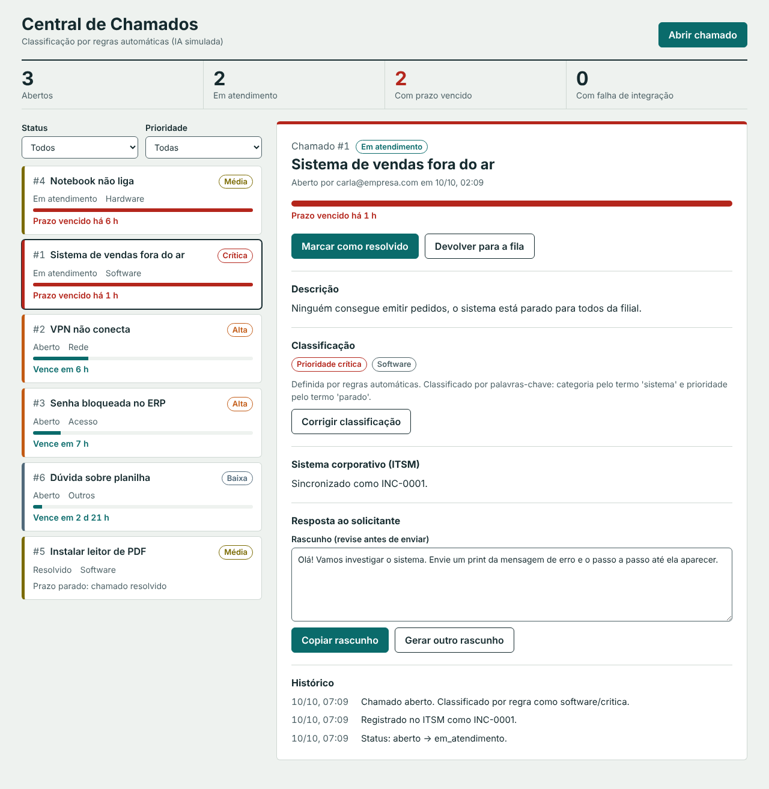
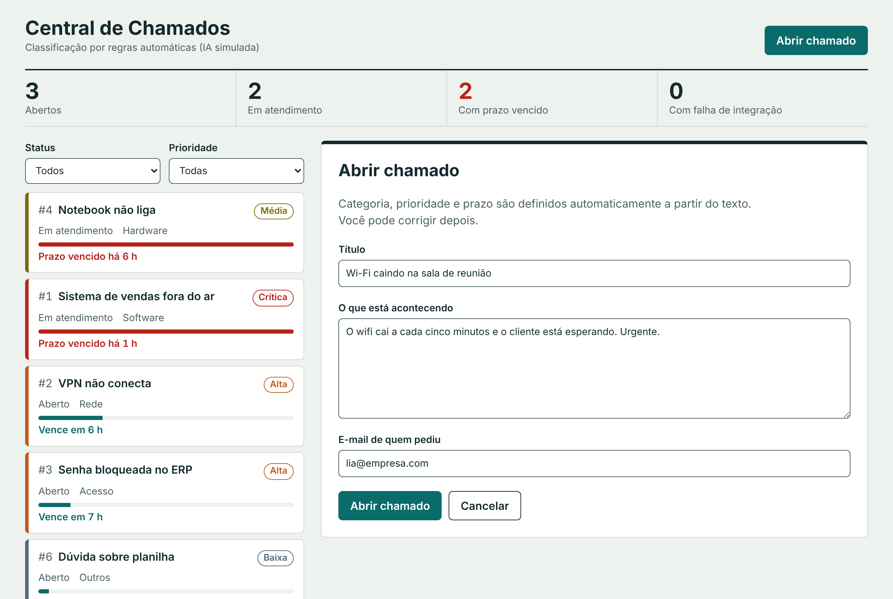
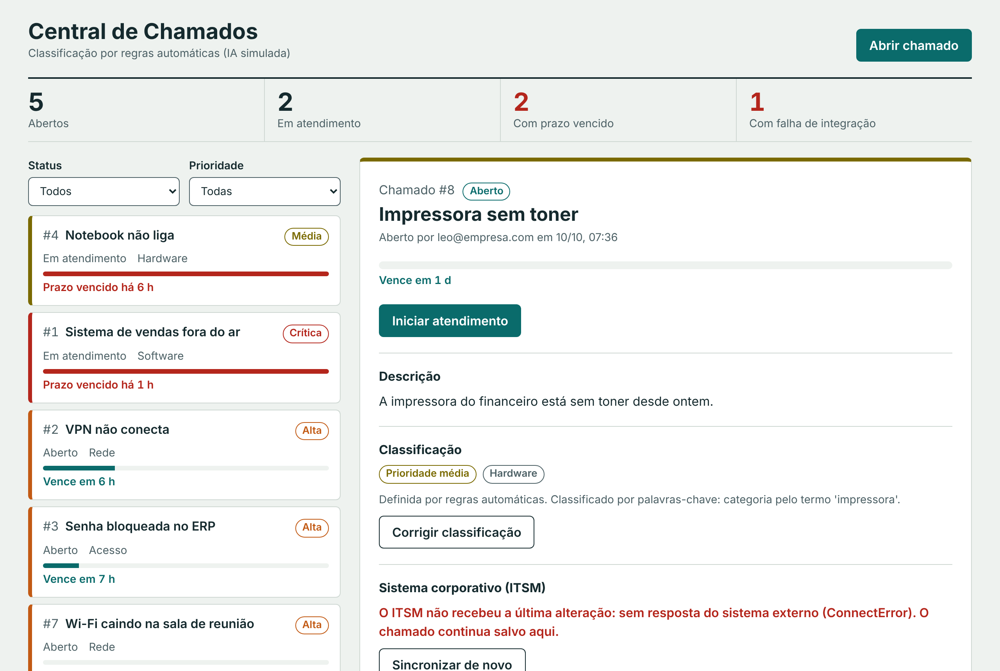
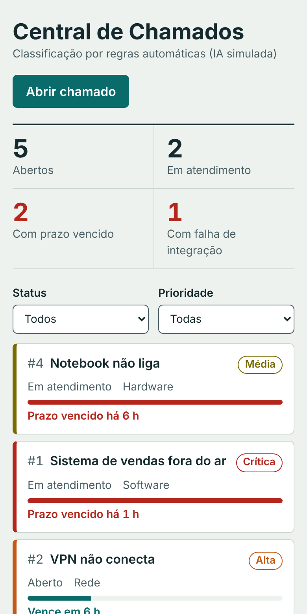

# Central de Chamados com IA

Sistema de chamados de suporte de TI. Quem abre o chamado escreve o problema em
texto livre; a aplicação classifica categoria e prioridade com IA generativa,
calcula o prazo de atendimento, registra o chamado no sistema corporativo da
empresa (ITSM) e mantém os dois lados sincronizados.



## Telas

**Abertura de chamado.** A pessoa descreve o problema; categoria, prioridade e
prazo são definidos automaticamente.



**Sistema corporativo fora do ar.** O chamado é salvo mesmo assim, fica marcado
com falha de integração e pode ser sincronizado depois.



**No celular.** A fila e a ficha se alternam em uma coluna só.



## O que o projeto demonstra

| Tema | Onde está |
|---|---|
| Integração com sistema corporativo | `backend/app/integracoes/itsm.py` (cliente HTTP com nova tentativa e idempotência) e `backend/app/rotas/webhooks.py` (webhook assinado com HMAC) |
| Serviços e regras de negócio | `backend/app/servicos/regras.py` (prazo por prioridade, máquina de estados) e `backend/app/servicos/chamados.py` |
| Componente de IA generativa | `backend/app/servicos/ia.py` (interface de provedor, validação da resposta, plano B, correção humana) |
| Documentação de API e arquitetura | `docs/contrato-api.md`, `docs/openapi.json`, `docs/decisoes/` |
| Python | FastAPI, SQLAlchemy 2, Pydantic, pytest (34 testes) |
| React + TypeScript | `frontend/src` (Vite, sem biblioteca de componentes) |

## Arquitetura

```
 Navegador                  API (Python)                    ITSM simulado
┌──────────────┐  /api   ┌─────────────────────┐  HTTP   ┌────────────────┐
│ React +      │ ──────▶ │ rotas → serviços    │ ──────▶ │ /incidentes    │
│ TypeScript   │ ◀────── │   ├ regras          │ ◀────── │ (webhook       │
│ (porta 5173) │         │   ├ IA (provedor)   │ webhook │  assinado)     │
└──────────────┘         │   └ integração ITSM │         │ (porta 8001)   │
                         │ SQLite (porta 8000) │         └────────────────┘
                         └─────────────────────┘
```

O ITSM simulado faz o papel de um sistema como ServiceNow: é um programa
separado, com nomes de campo e estados próprios, para a integração ter o que
traduzir.

## Como rodar

Testado com Python 3.13 e Node 22. Precisa de Python 3.11 ou mais novo.

Abra três terminais.

**Terminal 1: ITSM simulado**

```bash
cd backend
python -m venv .venv
# Windows:        .venv\Scripts\activate
# Linux ou macOS: source .venv/bin/activate
pip install -r requirements.txt
python -m uvicorn sistema_externo.main:app --port 8001
```

**Terminal 2: API**

```bash
cd backend
# ative o mesmo ambiente virtual do terminal 1
python -m scripts.popular          # opcional: cria chamados de exemplo
python -m uvicorn app.main:app --reload --port 8000
```

**Terminal 3: tela**

```bash
cd frontend
npm install
npm run dev
```

Abra http://localhost:5173. A documentação interativa da API fica em
http://localhost:8000/docs.

### Testes

```bash
cd backend
python -m pytest
```

Os testes não usam rede nem arquivo: o banco roda em memória e o ITSM é
substituído por um falso.

## Roteiro de demonstração

1. Abra um chamado com o texto "O sistema de vendas está parado para todos".
   Ele entra como prioridade crítica, com prazo de 4 horas e número no ITSM.
2. Clique em **Corrigir classificação** e mude a prioridade. O prazo é
   recalculado e o histórico registra que uma pessoa corrigiu.
3. Simule um técnico alterando o incidente dentro do ITSM:

   ```bash
   curl -X POST http://localhost:8001/incidentes/INC-0001/simular-atualizacao \
        -H "Content-Type: application/json" -d '{"state": "RESOLVED"}'
   ```

   Em até 15 segundos a tela mostra o chamado como resolvido (chegou por webhook).
   Se preferir não usar o terminal, faça a mesma chamada pela página
   http://localhost:8001/docs.
4. Pare o terminal do ITSM e abra outro chamado. Ele é salvo mesmo assim, com
   aviso de falha de integração. Ligue o ITSM de novo e clique em
   **Sincronizar de novo**.

## IA real (opcional)

Por padrão o projeto usa um classificador simulado por palavras-chave, que roda
sem internet e sem custo. Para usar um modelo de linguagem de verdade, copie
`backend/.env.exemplo` para `backend/.env` e preencha:

```
PROVEDOR_IA=anthropic
ANTHROPIC_API_KEY=sua-chave
```

A API da Anthropic é paga por uso. Se a chamada falhar ou o modelo responder
fora do formato, o sistema usa o classificador simulado e o chamado é aberto
normalmente.

Estado da verificação: o caminho com o modelo real é coberto por testes com um
cliente falso (`backend/tests/test_ia.py`), mas ainda não foi executado contra
a API real. Rode uma vez com a sua chave antes de demonstrar.

## Limites conhecidos

- Não há login nem controle de permissão.
- O banco é SQLite e as tabelas são criadas na subida, sem migrações.
- O prazo conta horas corridas, não horas úteis.
- A tela busca novidades a cada 15 segundos, em vez de receber em tempo real.
- O front-end não tem testes automatizados.

## Documentação

- [Contrato da API](docs/contrato-api.md)
- [Decisões de arquitetura](docs/decisoes/)
- [Guia de estudo](docs/guia-de-estudo.md): explicação de cada parte do código
